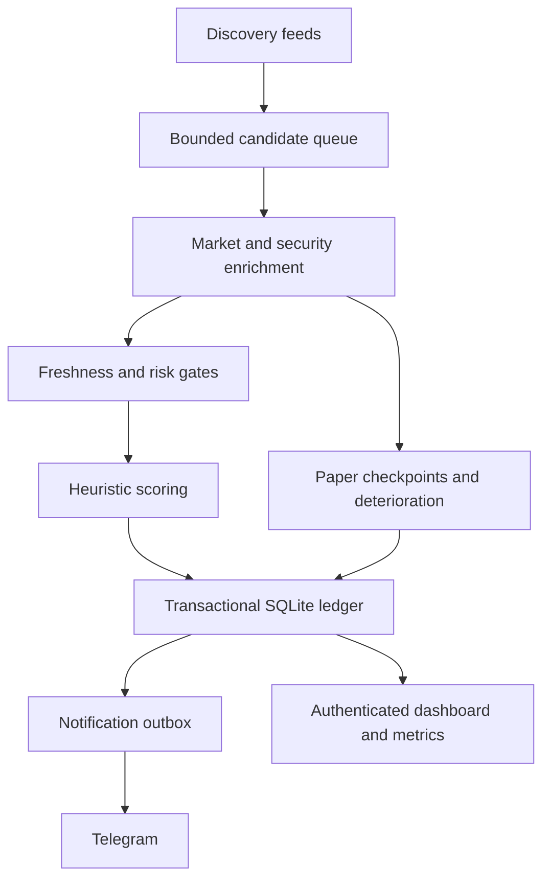

# Architecture and measurement contracts

## Persistence

SQLite WAL with synchronous FULL stores candidate JSON, append-only events with unique identities, key/value state, and an outbox. Candidate changes, alert events and queued notifications commit together. Checkpoint outcome identities are `(mint, entry time, horizon)`. Upgrading a signal from watch to strong retains its first paper entry and creates a separate alert event.

Candidate eviction never removes an open price-v2 paper entry. Archived paper identity survives candidate eviction to avoid treating a rediscovered completed mint as a completely new paper experiment. Snapshots are retained for a configurable period; ledger events are retained indefinitely. This is a single-scanner architecture, not a distributed database or a multi-writer service.

## Provider contract

- DEX is the market source for this release. A DEX outage does not become a synthetic market observation.
- Jupiter supplies organic activity, holders and discovery. Exact mint match is required. Null and absent values are unknown, not numeric zero or a clean audit.
- Helius supplies a parsed mint, authority state, extensions and largest-token-account balances. Concentration is calculated against raw integer supply. A missing or invalid mint prevents security verification.
- PumpPortal opens one socket for creation/migration events, reconnects with backoff and marks silence/disconnects. Trade subscriptions are absent.

Jupiter and Helius metadata work starts only once there are at least 15 recent transactions or the candidate has an open paper entry. This reduces API work on inactive launches but can delay very early signals. Provider pacing is conservative and sequential, so network latency reduces throughput further. Missing data lowers confidence rather than increasing a score.

## Freshness and score

A successful matched market response establishes `marketObservedAt`, using local response time. This prevents reuse after a failed fetch; it cannot establish freshness inside the upstream provider. Successful security results have a 5-minute default TTL. The decision path cannot emit default-threshold alerts when security fields are missing. Even when `REQUIRE_SECURITY=false`, scoring's incomplete-security cap remains; it is not a switch to bypass that cap.

Age uses the earliest available known launch/first-pool/pair timestamp. Without one it is explicitly time since first discovery. This still cannot prove the token mint's original on-chain creation time. The heuristic is saturated at 100 and remains uncalibrated. Rolling 5-minute count/volume changes are rolling-window slopes, not unique-buyer or per-trade acceleration.

## Paper observations

Each mint's first signal creates a `price-v2` entry with price, pair, score and market cap. Later samples use the same pair. A pair change is a coverage problem, not a seamless source substitution. At 5m, 15m and 60m, a quote within 90 seconds after the deadline can record the horizon ratio, with lateness. The running maximum for each horizon is frozen from samples at/before its deadline. Missing checkpoints are final rather than silently backfilled with future values.

`maxDrawdownPct` measures sampled drawdown from the prior observed price peak. `drawdownFromEntryPct` at checkpoints measures the worst sampled decline relative to entry during the window. They answer different questions. True highs/lows between polls, fills, position sizing and transaction costs are unknown.

## Deterioration

Four heuristics: >30% liquidity decline since the previous comparable snapshot; >=65% sells with >=15 recent trades; <=-20% 5m price change; >25% below the sampled post-entry peak. One flag is moderate, two or more high. High warnings on already alerted tokens use a 15-minute cooldown. Missing fresh data or a changed pair produces unknown. These overlapping heuristics are not a validated sell strategy.

## Monitoring

`/healthz`: HTTP process liveness. `/readyz`: live worker, recent loop activity and a recent market observation. `/api/health`: per-provider state, request observations, errors, notification status, queue age and drops. `/metrics`: bearer-protected Prometheus text. Readiness does not mean all providers are connected, security is complete, or every candidate meets latency targets.

Operations notifications can report degradation/recovery and a daily status digest only while the process and Telegram transport can run. A separate external monitor is required for complete machine/network failure. Docker health status does not itself restart an unhealthy-but-running container; restart policy handles exited processes.
